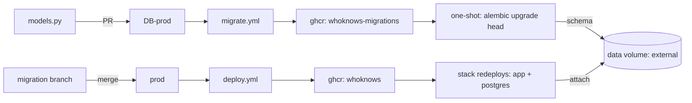

# Migration state (SQLite → PostgreSQL)

Postgres 17, Alembic owns the schema, and production data lives in one external Docker volume.



**Key points**

- **Schema** — Alembic chain head `d489fff393dd`; mirrors the old SQLite schema column-for-column
- **Data** — one external volume, named via env `POSTGRES_VOLUME_NAME` (cloud) / `whoknows_postgres_data` (local). `external: true` keeps the declared name and survives `down -v` / resource cleanup. Exactly one postgres ever mounts it.
  - *Version lock: the data volume only opens under the PG major that wrote it (`postgres:17` is load-bearing); a major upgrade needs a planned `pg_upgrade`, never an image bump.*
- **App** — lib/pq, `DATABASE_URL` + `SESSION_SECRET` (≥32 chars) from env (root `.env` locally). API payloads are form-encoded.

**Local dev**

```bash
cp .env.example .env                          # repo root, fill in
pip install -r migrations/alembic/requirements.txt   # python deps for alembic (needs Python 3)
docker volume create whoknows_postgres_data   # once — the volume is external
docker compose up -d postgres                 # Postgres 17 on 127.0.0.1:5432
cd migrations/alembic && alembic upgrade head  # first run only
cd src && go run .                            # reads ../.env fallback
```

**Alembic rules** — author locally only; autogenerate does *not* detect `server_default` changes, review every generated file; never delete applied revisions; commit `versions/` + `models.py` and PR to `DB-prod`.
